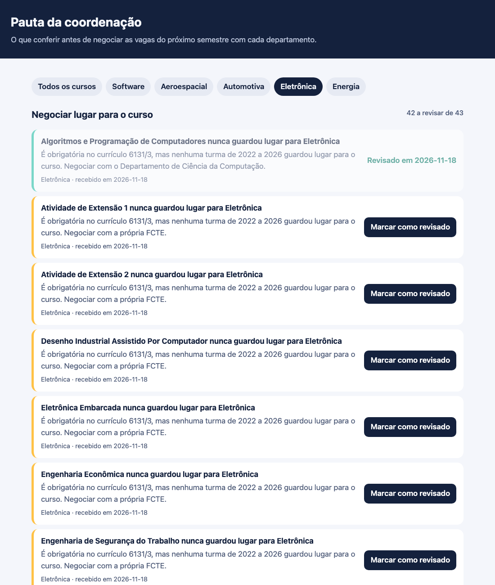

# ETL reverso: a Pauta da coordenação

O dado tratado volta para um sistema onde alguém age. A **Pauta da coordenação** ([`coordenacao/`](https://github.com/Trajetorias-Academicas-BD2-2026-2/Trajetorias-academicas/blob/main/coordenacao/app.py)) é um sistema separado do warehouse, com banco próprio. O coordenador abre a pauta antes da reunião de negociação de vagas com cada departamento, confere cada item e o marca como revisado.

## O que chega à pauta

Os itens são montados a partir das [métricas oficiais](../dados/camada-semantica.md):

| Tipo | Regra | Itens | O que o coordenador faz |
|---|---|---:|---|
| Confirmar reserva grande | a matéria guardou 50 lugares ou mais no último semestre | 23 | confirma com o departamento se a reserva é real |
| Negociar lugar para o curso | obrigatória que nunca guardou lugar de 2022 a 2026 | 169 | negocia com o departamento indicado |
| Entender a queda | lugares caíram pela metade ou mais de 2022 para 2025 | 14 | pergunta ao departamento o que mudou |

## Entrega garantida, sem duplicar

`analytics/etl_reverso.py` grava cada item numa fila de envio (`operations.envio_pauta`) e só marca "enviado" depois de a Pauta confirmar. Cada envio leva um `Idempotency-Key` com a versão do conteúdo, e a Pauta faz upsert.

Demonstração ([evidência](https://github.com/Trajetorias-Academicas-BD2-2026-2/Trajetorias-academicas/blob/main/docs/evidencias/e4-etl-reverso.txt)):

1. **Pauta fora do ar:** 206 itens ficam pendentes, com o erro registrado. O pipeline **não falha**.
2. **A Pauta volta:** a próxima execução entrega os 206.
3. **Nova execução sem mudança:** nada é reenviado.
4. **Reenvio forçado da mesma versão:** o destino responde "já existia" 206 vezes e continua com 206 itens.
5. **O coordenador** marca um item como revisado.

**Opção nula:** `analytics/exportar_pauta_csv.py` gera os mesmos itens como CSV por curso (`saida/pauta_<curso>.csv`). Ficou como saída paralela. A comparação está no [ADR-0007](../decisoes/0007-disponibilizacao-e4.md): o CSV não guarda o que o coordenador já revisou.
