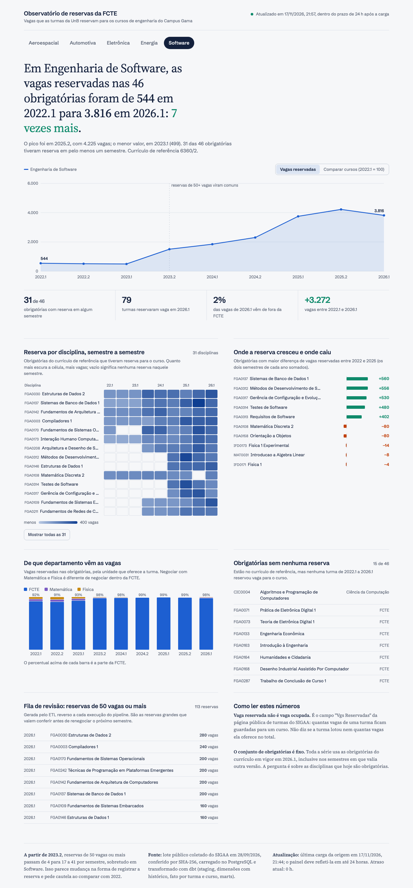

# Painel

O serviço `dashboard` publica o observatório em `http://localhost:8080`. Ele responde à pergunta da E1 para um curso por vez e lê só a camada de consumo: `mart_observatorio`, `mart_disciplina_semestre`, `mart_cobertura_curriculo`, `metricas_freshness` e a fila `operations.alertas_reserva`.

## O que mostra

| Bloco | Pergunta que responde |
|---|---|
| Frase-resposta e série | Como evoluíram as vagas reservadas do curso nas obrigatórias, de 2022.1 a 2026.1, com o pico e o menor valor |
| Comparar cursos (índice 2022.1 = 100) | O curso cresceu ou caiu mais que os outros? |
| Números de apoio | Quantas obrigatórias tiveram reserva, quantas turmas reservaram vaga, quanto vem de fora da FCTE, variação absoluta |
| Matriz disciplina × semestre | Em quais obrigatórias e semestres a reserva aparece ou some |
| Onde a reserva cresceu e onde caiu | As 5 obrigatórias que mais ganharam e as 5 que mais perderam entre 2022 e 2025 |
| De que departamento vêm as vagas | Parte da FCTE, Matemática, Física e outras unidades, por semestre |
| Obrigatórias sem nenhuma reserva | O que está no currículo e nunca teve reserva no recorte |
| Fila de revisão | Reservas de 50 vagas ou mais, geradas pelo ETL reverso |
| Atualização | Data do processamento e se o mart está dentro do SLA de 24 h |

- **Link direto:** `?curso=FGA_ELET&modo=indice` abre o painel num curso e na escala comparada.
- **Acesso:** funciona por teclado, nos modos claro e escuro, e a partir de 360 px de largura.

## Implementação

- [`dashboard/app.py`](https://github.com/Trajetorias-Academicas-BD2-2026-2/Trajetorias-academicas/blob/main/dashboard/app.py) serve a página e `GET /api/observatorio`, um JSON com os blocos.
- [`dashboard/static/index.html`](https://github.com/Trajetorias-Academicas-BD2-2026-2/Trajetorias-academicas/blob/main/dashboard/static/index.html) desenha os gráficos em SVG no navegador, sem biblioteca de gráficos nem CDN de JavaScript.
- Se o banco ou a camada analítica não estiverem prontos, a API responde 503 com a instrução para rodar o pipeline.
