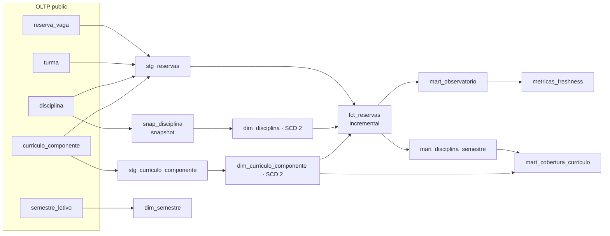

# Camada analítica

Transformações em **dbt**, no schema `analytics` do mesmo PostgreSQL. O código está em [`analytics/`](https://github.com/Trajetorias-Academicas-BD2-2026-2/Trajetorias-academicas/tree/main/analytics) e as decisões, no [ADR-0006](../decisoes/0006-camada-analitica-observatorio-e3.md).

## Esquema estrela

| Modelo | Granularidade | Linhas |
|---|---|---:|
| `fct_reservas` | uma linha por **turma e curso**: as vagas que uma turma de um semestre reservou para um curso | 1.776 |
| `dim_curso` | uma por curso | 5 |
| `dim_semestre` | uma por semestre do calendário | 10 |
| `dim_disciplina` | uma por **versão** de disciplina | 633 |
| `dim_curriculo_componente` | uma por disciplina num curso, por versão curricular | 625 |

Estrela, e não Data Vault nem one big table:

- **Fonte e esquema:** há uma fonte só, com esquema estável.
- **Contagem dupla:** a mesma turma aparece em até 5 cursos, então uma tabela única contaria a turma várias vezes ao somar por disciplina.

## Granularidade, medida

| Granularidade | Linhas | Responde |
|---|---:|---|
| turma × curso (fato) | 1.776 | tudo, até a turma |
| curso × disciplina × semestre | 676 | série e perguntas por disciplina |
| curso × semestre | 45 | só o total da pergunta |

Guardamos a fina e materializamos as grossas como marts.

## Dimensões de variação lenta

- **`dim_disciplina`: SCD 2 em tempo de processamento.**
    - **Origem:** o snapshot dbt `snap_disciplina` compara nome, carga horária, tipo e unidade.
    - **Comportamento:** quando um valor muda, fecha a versão anterior (`valid_to`) e abre outra (`is_current`).
    - **Ligação com o fato:** cada reserva aponta para a versão vigente quando foi ingerida (`disciplina_sk`).
    - **Demonstração:** renomear FGA0137 no OLTP gera a segunda versão, e reverter gera a terceira ([`scd.txt`](https://github.com/Trajetorias-Academicas-BD2-2026-2/Trajetorias-academicas/blob/main/docs/evidencias/scd.txt)).
- **`dim_curriculo_componente`: SCD 2 em tempo de negócio.**
    - **Vigência:** a natureza vale do semestre de início de uma versão curricular até o início da seguinte.
    - **Exemplo:** em Automotiva, 4 disciplinas trocam de natureza entre 6297/2 e 6297/3.
    - **No fato:** `natureza_na_epoca` traz essa natureza (nula quando a versão daquela época não foi coletada), ao lado de `obrigatoria`, que segue o currículo fixo de 2026.1 pedido pela pergunta.

## Fato incremental

`fct_reservas` é `incremental` com `delete+insert` por `semestre_key`:

- **Sem variável:** reprocessa só os semestres que receberam linha nova. Isso cobre o dado atrasado de semestre antigo.
- **`backfill_semestre`:** refaz uma janela.
- **`--full-refresh`:** reconstrói tudo.

Ver [Orquestração](../pipeline/orquestracao.md#backfill).

## Marts de consumo

| Mart | Para quê |
|---|---|
| `mart_observatorio` | Resposta à pergunta: curso × semestre, só obrigatórias do currículo de referência |
| `mart_disciplina_semestre` | Matriz disciplina × semestre e maiores variações |
| `mart_cobertura_curriculo` | Cada obrigatória do currículo de referência, inclusive as que nunca tiveram reserva |
| `metricas_freshness` | Freshness e SLA do `mart_observatorio` |

## Freshness e SLA

- **Origem:** `dbt source freshness` em `turma` e `reserva_vaga`, com aviso em 200 dias e erro em 400. O dado chega uma vez por semestre.
- **Tabela de consumo:** o `mart_observatorio` reflete uma carga nova em até **24 horas**.
    - A view `metricas_freshness` mede `atraso_horas`, a diferença entre a última carga da origem e a do mart.
    - O teste `test_sla_freshness_mart` falha se esse atraso passar de 24 h.
    - O painel mostra o valor.
