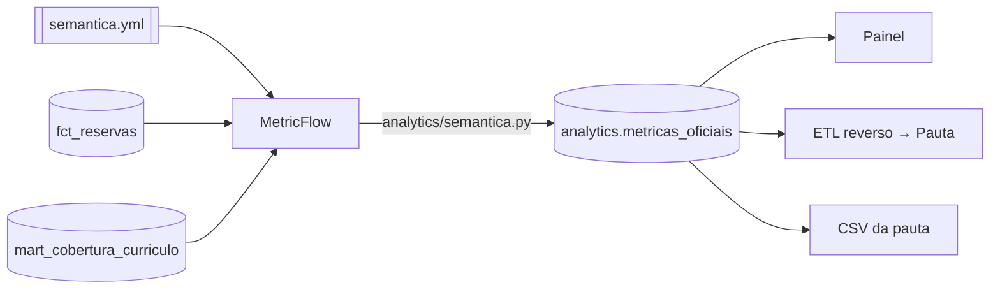

# Camada semântica: uma definição por métrica

Na E3, a mesma métrica era calculada em três lugares: o SQL do mart, o JavaScript do painel e o Python do ETL reverso. Nada garantia que batessem. Na E4, toda métrica do observatório é definida **uma vez**, no MetricFlow (camada semântica do dbt), em [`analytics/models/semantic/semantica.yml`](https://github.com/Trajetorias-Academicas-BD2-2026-2/Trajetorias-academicas/blob/main/analytics/models/semantic/semantica.yml).

| Métrica | O que é | Tipo |
|---|---|---|
| `lugares_guardados` | Lugares que as turmas guardaram para o curso nas obrigatórias do currículo de referência (soma de "Vgs Reservadas") | soma |
| `turmas_que_guardaram` | Turmas distintas com lugar guardado para o curso | contagem distinta |
| `materias_com_reserva` | Obrigatórias distintas com lugar guardado | contagem distinta |
| `lugares_outros_departamentos` | Lugares em turmas de fora da FCTE | soma |
| `participacao_outros_departamentos` | Parte dos lugares que vem de fora da FCTE | razão |
| `obrigatorias_no_curriculo` | Obrigatórias no currículo de referência | contagem |
| `obrigatorias_cobertas` | Obrigatórias que guardaram lugar alguma vez | contagem |
| `cobertura_curricular` | Parte das obrigatórias que guardou lugar alguma vez | razão |

Cada métrica tem descrição em linguagem simples, rótulo e versão (`meta.versao`). O painel mostra essas descrições no rodapé "Como cada número é calculado".

## Como os consumidores leem

`analytics/semantica.py` pede os valores ao MetricFlow (`mf query`) e grava `analytics.metricas_oficiais` numa transação: 820 valores, por curso × semestre, por disciplina e por departamento. Nenhum consumidor recalcula métrica.

## O teste implacável

`tests/metricas_consistentes.py` roda no CI e compara, para todo curso e semestre:

1. o MetricFlow calculando agora;
2. a tabela oficial;
3. o mart da E3, um caminho SQL independente;
4. a API do painel;
5. a Pauta da coordenação.

Resultado: **586 valores, 0 divergências**. Uma "correção manual" provocada, de 3.816 para 3.900, é pega pelo teste, que sai com código 1 ([evidência](https://github.com/Trajetorias-Academicas-BD2-2026-2/Trajetorias-academicas/blob/main/docs/evidencias/e4-consistencia.txt)).

Decisão e medições no [ADR-0007](../decisoes/0007-disponibilizacao-e4.md).
