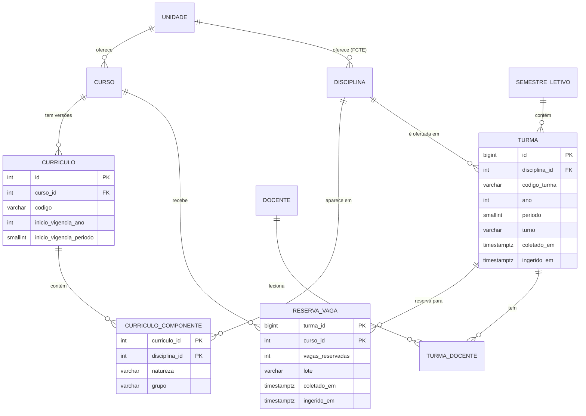

# Modelo OLTP

Esquema `public` do PostgreSQL 16, criado por 11 migrações versionadas em [`db/migrations/`](https://github.com/Trajetorias-Academicas-BD2-2026-2/Trajetorias-academicas/tree/main/db/migrations). Elas são aplicadas em ordem por `db/migrate.sh`, cada uma numa transação, com controle em `schema_migrations`. Qualquer erro de SQL interrompe a subida.

| Tabela | Linhas | O que guarda |
|---|---:|---|
| `turma` | 733 | Uma turma de um semestre encerrado; chave natural `(disciplina, turma, ano, período)` |
| `reserva_vaga` | 1.776 | Vagas que uma turma reserva para um curso; chave `(turma_id, curso_id)` |
| `turma_docente` | 773 | Docentes de cada turma |
| `disciplina` | 633 | Catálogo da FCTE e disciplinas de outras unidades citadas (`unidade_id` nulo) |
| `curriculo` / `curriculo_componente` | 6 / 625 | Versões curriculares e a natureza de cada componente |
| `curso` | 5 | Os cinco cursos de engenharia do Campus Gama |
| `semestre_letivo` | 10 | Calendário oficial, com a data de encerramento e a fonte |

Restrições: `NOT NULL`, chaves estrangeiras em todos os vínculos e `CHECK` em vagas (> 0), período (1 ou 2), turno, natureza e tipo. A view `curriculo_referencia` fixa a versão em vigor em 2026.1 (V005).

## Histórico: insert-only

- **`turma`, `turma_docente` e `reserva_vaga` são insert-only:** triggers da V003 levantam erro em `UPDATE`, `DELETE` e `TRUNCATE`. Cada semestre gera linhas novas, e a série histórica não pode ser reescrita.
- **Só semestres encerrados entram:** um trigger recusa turma cujo semestre não terminou segundo o calendário. Um retrato parcial distorceria a série.
- **Reprocessar o mesmo lote não altera nada.** Um lote que traga **outro valor** para uma reserva já carregada é recusado inteiro, e as diferenças vão para `debug/divergencias.csv`.
- **Catálogo e currículo usam upsert:** uma correção do SIGAA sobrescreve o valor no OLTP. O histórico dessas mudanças é preservado na camada analítica, pela [SCD](camada-analitica.md#dimensoes-de-variacao-lenta).

**O que isso permite perguntar:** como evoluíram as reservas por curso, disciplina e semestre; quais obrigatórias tiveram reserva e quando; quanto vem de cada unidade; quantas turmas são compartilhadas.

**O que não permite:** como a reserva mudou durante o semestre, nem qual versão do catálogo valia num semestre passado, exceto a partir de quando a SCD começou a registrar.

## Carimbos de tempo

| Coluna | Significado |
|---|---|
| `ano`, `periodo` | Tempo do **evento**: o semestre da turma |
| `coletado_em` | Quando a página do SIGAA foi lida |
| `ingerido_em` | Quando a linha entrou no banco |

Todos com fuso (`TIMESTAMPTZ`). Um teste garante que `coletado_em` nunca é posterior a `ingerido_em`. Toda linha carrega `fonte` e `lote` para linhagem.

## Migrações

| Versão | O que faz |
|---|---|
| V001–V002 | Esquema base e correções |
| V003 | Reservas por curso, currículo versionado, triggers insert-only |
| V004 | Calendário acadêmico e trigger de semestre encerrado |
| V005 | Currículo de referência fixo em 2026.1 |
| V006 | Outbox e checkpoint da E2 |
| V007 | Schemas `analytics` e `operations`, papel `dashboard_reader`, fila do ETL reverso |
| V008 | Índices de consumo |
| V009 | Schema `ml` com pgvector |
| V010 | CDC sobre as tabelas reais (`reserva_vaga`, `disciplina`, `curriculo_componente`) |
| V011 | Remove índice idêntico à chave primária de `reserva_vaga` |
