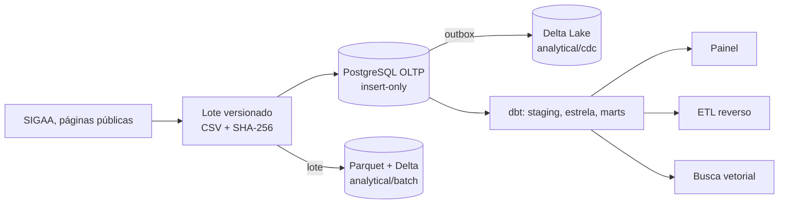

---
hide:
  - toc
---

# Observatório de reservas da FCTE

<div class="project-hero" markdown>

<span class="project-eyebrow">BD2 · FCTE/UnB · 2026.2 · Squad G2</span>

## Como evoluíram, entre 2022.1 e 2026.1, as vagas reservadas publicadas para cada curso da FCTE nas disciplinas obrigatórias do currículo de referência de 2026.1?

Uma plataforma de dados que coleta as páginas públicas do SIGAA, guarda o histórico num banco transacional insert-only, leva as mudanças para um armazenamento analítico aberto e responde à pergunta num painel para o coordenador de curso.

[Entender o projeto](projeto/visao-geral.md){ .md-button .md-button--primary }
[Ver as entregas](entregas/e1.md){ .md-button }
[Abrir o painel](https://trajetorias-academicas-bd2-2026-2.github.io/Trajetorias-academicas/){ .md-button }
[Código no GitHub](https://github.com/Trajetorias-Academicas-BD2-2026-2/Trajetorias-academicas){ .md-button }

</div>

## A resposta, em uma tabela

Vagas reservadas para cada curso nas obrigatórias do currículo de referência, primeiro e último semestre do recorte:

| Curso | 2022.1 | 2026.1 | Variação | Obrigatórias com reserva no período |
|---|---:|---:|---:|---:|
| Engenharia de Software | 544 | 3.816 | 7,0 vezes | 31 de 46 |
| Engenharia Aeroespacial | 148 | 105 | −29% | 13 de 51 |
| Engenharia Automotiva | 192 | 92 | −52% | 16 de 51 |
| Engenharia de Energia | 172 | 90 | −48% | 13 de 51 |
| Engenharia Eletrônica | 294 | 77 | −74% | 12 de 55 |

Vaga reservada **não é** vaga ocupada nem oferta total da turma: é o campo "Vgs Reservadas" que a página de cada curso publica. A partir de 2023.2 as reservas de 50 vagas ou mais ficam comuns, sobretudo em Software, o que parece mudança na forma de registro. Detalhes em [Visão geral](projeto/visao-geral.md#o-que-os-dados-nao-respondem).

## Entregas

<div class="grid cards" markdown>

- :material-database-outline: **E1 · Fonte transacional**

    ---

    PostgreSQL com 11 migrações, carga reprodutível de um lote público conferido por SHA-256, histórico insert-only e carga de trabalho caracterizada.

    [Entrega E1](entregas/e1.md)

- :material-transit-connection-variant: **E2 · Ingestão em lote e CDC**

    ---

    Lote idempotente para Parquet + Delta Lake, CDC por outbox transacional com MERGE, dado atrasado tratado por janela, semântica demonstrada.

    [Entrega E2](entregas/e2.md)

- :material-chart-box-outline: **E3 · Camada analítica**

    ---

    Esquema estrela em dbt com duas dimensões de variação lenta, 45 testes, grafo com retry e backfill, consulta otimizada pelo plano e painel.

    [Entrega E3](entregas/e3.md)

</div>

## O caminho do dado



Explicação de cada camada em [Arquitetura](projeto/arquitetura.md).

## Rodar

```bash
git clone https://github.com/Trajetorias-Academicas-BD2-2026-2/Trajetorias-academicas.git
cd Trajetorias-academicas
docker compose up --build        # banco, migrações, carga, dbt e painel em http://localhost:8080
```

O Postgres fica exposto na porta 5433 do host (`DB_PORT_HOST` para trocar).

## Equipe

Ana Joyce · Gustavo Alves · Gabriel Lima da Silva · Nathan Abreu · Guilherme Evangelista · Angélica Campos · Davi Araújo

*Sistemas de Banco de Dados 2 · Turma 3 · 2026.2 · FCTE/UnB.*
