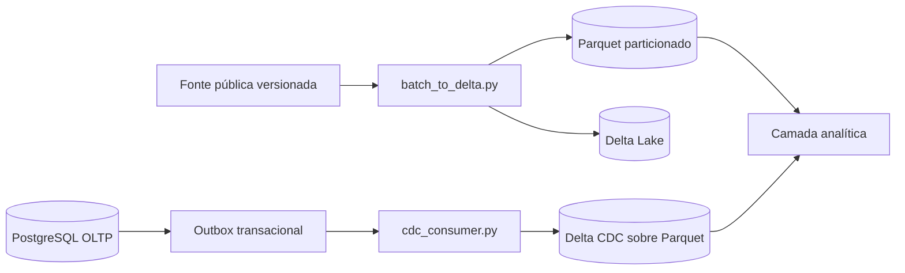

# E2 — Ingestão em lote e captura de mudanças

Esta página documenta a implementação da Entrega E2. O código executável
fica no repositório da aplicação, na branch
[`feat/e2-ingestao-cdc-parquet`](https://github.com/Trajetorias-Academicas-BD2-2026-2/Trajetorias-academicas/tree/feat/e2-ingestao-cdc-parquet).

## Arquitetura



O lote e o caminho de mudanças são deliberadamente separados. A fonte pública
tem atualização semestral e não justifica streaming contínuo; o OLTP, por sua
vez, precisa demonstrar que uma alteração chega ao destino analítico.

## Caminho em lote

[`batch_to_delta.py`](https://github.com/Trajetorias-Academicas-BD2-2026-2/Trajetorias-academicas/blob/feat/e2-ingestao-cdc-parquet/ingestion/batch_to_delta.py)
faz o seguinte:

1. lê `ofertas_por_curso.csv` do lote versionado;
2. valida as colunas obrigatórias e rejeita fonte vazia;
3. calcula o SHA-256 da entrada;
4. grava Parquet particionado por `ano` e `periodo`;
5. aplica compressão Zstandard;
6. publica uma tabela Delta sobre Parquet;
7. grava um manifesto com fonte, checksum, contagem e política de entrega.

A execução validada processou **1.786 linhas**, distribuídas em **9 arquivos
Parquet** na tabela Delta. A mesma entrada foi executada duas vezes e
permaneceu com 1.786 linhas: o modo `overwrite` evita duplicação por
reprocessamento.

## Caminho de mudanças

A migration
[`V006__e2_ingestao.sql`](https://github.com/Trajetorias-Academicas-BD2-2026-2/Trajetorias-academicas/blob/feat/e2-ingestao-cdc-parquet/db/migrations/V006__e2_ingestao.sql)
cria:

- uma tabela OLTP demonstrativa;
- uma outbox com sequência monotônica;
- um checkpoint por consumidor;
- um trigger para `INSERT`, `UPDATE` e `DELETE`.

[`demo_change.py`](https://github.com/Trajetorias-Academicas-BD2-2026-2/Trajetorias-academicas/blob/feat/e2-ingestao-cdc-parquet/ingestion/demo_change.py)
altera o OLTP. O trigger grava o evento na mesma transação. Em seguida,
[`cdc_consumer.py`](https://github.com/Trajetorias-Academicas-BD2-2026-2/Trajetorias-academicas/blob/feat/e2-ingestao-cdc-parquet/ingestion/cdc_consumer.py)
reconstrói o estado por chave e publica a tabela Delta.

Na demonstração, `E2-DEMO-001` passou de 30 para 35 vagas. Uma terceira
execução do consumidor não criou uma segunda linha.

## Semântica de entrega

O fluxo declara **at-least-once com deduplicação determinística**:

- o consumidor pode reler eventos se falhar antes do checkpoint;
- a publicação reconstrói uma linha por `aggregate_key`;
- o checkpoint avança somente depois da escrita;
- uma reexecução do lote substitui a tabela derivada, em vez de fazer
  `append` cego.

Não declaramos exactly-once: a confirmação do evento e a publicação no
armazenamento são operações distintas.

## Dado atrasado

O período do evento define a partição, não o horário em que o consumidor o
processa. Se uma coleta posterior trouxer um registro de período antigo, a
janela `ano/periodo` é reprocessada e publicada novamente. Assim, o evento
atrasado não é colocado na janela errada nem descartado.

## Execução

Na raiz do repositório da aplicação:

```bash
docker compose down -v
docker compose up --build
docker compose run --rm tests
docker compose run --rm --build e2-batch
docker compose run --rm --build e2-cdc \
  python ingestion/demo_change.py --id E2-DEMO-001 --vagas 30
docker compose run --rm --build e2-cdc
docker compose run --rm --build e2-cdc \
  python ingestion/demo_change.py --id E2-DEMO-001 --vagas 35
docker compose run --rm --build e2-cdc
docker compose run --rm --build e2-cdc
docker compose run --rm --build e2-cdc \
  python ingestion/verify_e2.py
```

O ADR da escolha está em
[ADR-003 — Mecanismo de ingestão da E2](../decisoes/adr-003-ingestao-e2.md).
