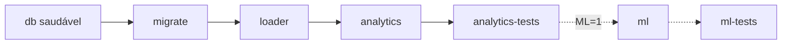

# Orquestração

## Grafo

[`orchestration/run_pipeline.sh`](https://github.com/Trajetorias-Academicas-BD2-2026-2/Trajetorias-academicas/blob/main/orchestration/run_pipeline.sh) executa as etapas em ordem, com retry por etapa:

`analytics` é o [`analytics/run.sh`](https://github.com/Trajetorias-Academicas-BD2-2026-2/Trajetorias-academicas/blob/main/analytics/run.sh):

1. `dbt source freshness`;
2. `dbt build` (snapshot SCD, modelos, testes);
3. ETL reverso.

- **Ordem:** cada etapa roda com `--no-deps`, então quem manda é o script, não o Compose.
- **Retry:** uma etapa repete até `RETRIES` vezes (padrão 3), esperando `BACKOFF`, 2×`BACKOFF`… segundos.
- **Desistência:** esgotadas as tentativas, o script sai com código 1 e as etapas seguintes não rodam.

**Agendamento:** [`orchestration/crontab`](https://github.com/Trajetorias-Academicas-BD2-2026-2/Trajetorias-academicas/blob/main/orchestration/crontab) roda todo dia às 02:00, com log em `logs/pipeline.log`.

**Por que script + cron (a opção nula) e não Airflow ou Dagster:** o grafo é linear, tem 5 etapas, roda uma vez por dia e leva cerca de 20 s. Um orquestrador somaria scheduler, webserver e banco de metadados ao Compose. Gatilho de revisão: mais de 10 etapas, dependências não lineares ou necessidade de histórico de execuções ([ADR-0006](../decisoes/0006-camada-analitica-observatorio-e3.md)).

## Retry com dependência derrubada

Evidência em [`retry.txt`](https://github.com/Trajetorias-Academicas-BD2-2026-2/Trajetorias-academicas/blob/main/docs/evidencias/retry.txt):

- **Cenário A:** `docker compose stop db`, e o banco volta 3 s depois. A etapa `db` falha duas vezes, passa na 3ª tentativa, e o resto do grafo roda.
- **Cenário B:** o banco fica fora do ar durante todas as tentativas (`RETRIES=2`). O pipeline desiste, sai com `exit=1` e não roda o loader nem o dbt.

## Backfill

`fct_reservas` é incremental por janela de semestre:

| Comando | O que refaz |
|---|---|
| `./orchestration/run_pipeline.sh` | só os semestres com linha ingerida depois da última execução |
| `BACKFILL_SEMESTRE=2024.1 ./orchestration/run_pipeline.sh` | só a janela 2024.1 |
| `FULL_REFRESH=1 docker compose run --rm analytics` | o fato inteiro |

Em [`backfill-2024.1.txt`](https://github.com/Trajetorias-Academicas-BD2-2026-2/Trajetorias-academicas/blob/main/docs/evidencias/backfill-2024.1.txt), só 2024.1 ganha `processado_em` novo (`INSERT 0 174`). As contagens e as vagas dos 9 semestres continuam iguais.
