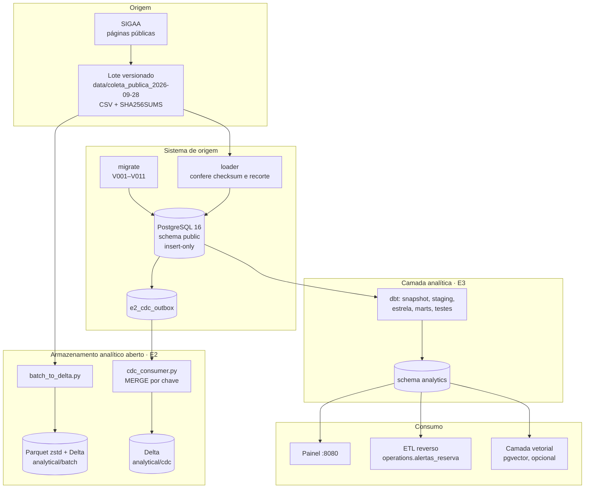

# Arquitetura

Tudo roda com Docker Compose num único `docker compose up`. Os serviços e a ordem de execução estão em [`docker-compose.yml`](https://github.com/Trajetorias-Academicas-BD2-2026-2/Trajetorias-academicas/blob/main/docker-compose.yml).

| Serviço | Papel | Detalhe |
|---|---|---|
| `db` | PostgreSQL 16 com pgvector | [Modelo OLTP](../dados/modelo-oltp.md) |
| `migrate` | Aplica `db/migrations/V*.sql` em ordem, cada uma numa transação | [Modelo OLTP](../dados/modelo-oltp.md) |
| `loader` | Confere o lote por SHA-256, valida o recorte e carrega numa transação | [Fonte e coleta](../dados/fonte-e-coleta.md) |
| `e2-batch`, `e2-cdc` | Lote para Parquet/Delta e consumidor da outbox (perfil `e2`) | [Ingestão](../pipeline/ingestao.md) |
| `analytics` | `dbt source freshness`, `dbt build`, ETL reverso | [Camada analítica](../dados/camada-analitica.md) |
| `dashboard` | Painel do observatório | [Painel](../consumo/painel.md) |
| `tests`, `analytics-tests`, `ml`, `ml-tests` | Testes de dados e camada vetorial (perfis `test` e `ml`) | [Qualidade](../pipeline/qualidade.md) |

## Escolhas que definem a arquitetura

| Escolha | Por quê | Registro |
|---|---|---|
| Lote versionado no repositório, não raspagem a cada carga | O SIGAA muda de layout e cai; o lote tem 903 kB e reproduz o mesmo banco offline | [ADR-0004](../decisoes/0004-coleta-publica-versionada.md) |
| OLTP insert-only para turma e reserva | A pergunta compara semestres; sobrescrever apagaria o passado | [ADR-0003](../decisoes/0003-reservas-por-curso-e-curriculo-versionado.md) |
| CDC por outbox transacional, não Debezium | Recarga leva menos de 3 s e o dado muda uma vez por semestre; outbox mostra a mudança sem Kafka | [ADR-0005](../decisoes/0005-ingestao-e2.md) |
| Delta Lake, não Iceberg | Commit atômico sem catálogo e MERGE no cliente Python | [ADR-0005](../decisoes/0005-ingestao-e2.md) |
| Estrela em dbt, orquestrada por script + cron | Uma fonte, esquema estável, pipeline linear de 20 s | [ADR-0006](../decisoes/0006-camada-analitica-observatorio-e3.md) |
